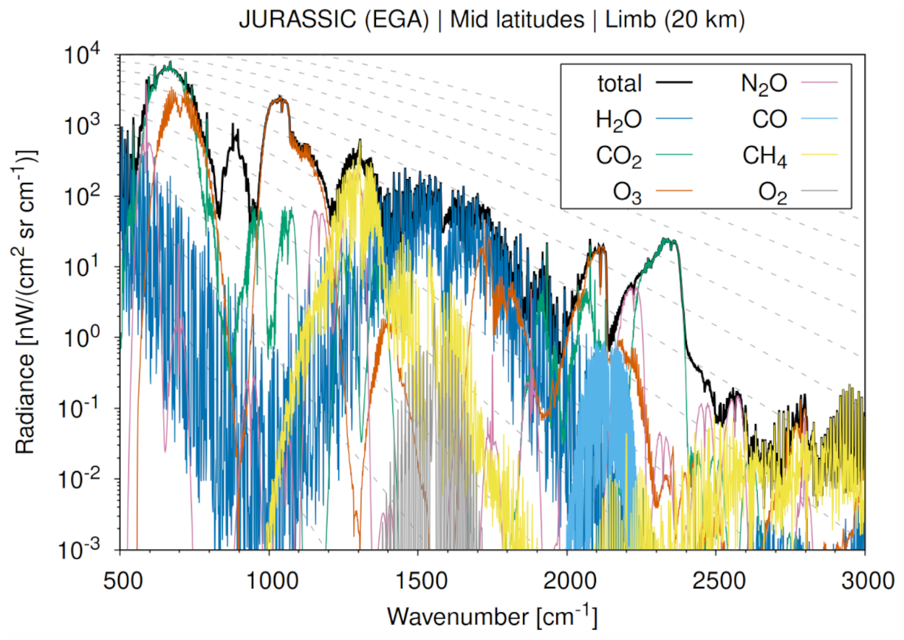

# Welcome to JURASSIC!

The Jülich Rapid Spectral Simulation Code (JURASSIC) is an open-source
infrared radiative transfer and retrieval model for atmospheric remote
sensing. It simulates atmospheric radiances and transmittances in the
mid-infrared spectral region (approximately 3–20 µm) and is designed
for research applications that require many repeated forward-model
calculations, including satellite data analysis, retrieval development,
and sensitivity studies.

JURASSIC combines efficient radiative transfer approximations with
precomputed spectroscopic lookup tables. It supports several viewing
geometries and includes an integrated framework for retrieving
atmospheric state variables from measured radiances.

## Key features

- **Infrared radiative transfer:** JURASSIC simulates atmospheric
  radiances and transmittances for limb, nadir, zenith, and occultation
  viewing geometries. The model supports satellite and other remote
  sensing applications with different observation geometries.

- **Fast spectroscopic calculations:** The Emissivity Growth
  Approximation (EGA) and Curtis–Godson Approximation (CGA) are
  combined with precomputed emissivity lookup tables derived from
  line-by-line spectroscopy. This approach reduces the cost of
  repeated calculations for specified instrument channels and
  atmospheric conditions.

- **Atmospheric retrievals:** An integrated optimal estimation
  framework retrieves atmospheric state variables, including
  temperature and trace gas abundances, from radiance measurements.
  Finite-difference Jacobians connect the forward model to iterative
  inversion and sensitivity analysis.

- **Flexible research workflows:** Users can configure atmospheric
  profiles, spectral channels, and observation geometries for
  instrument-specific studies. NetCDF input and output support
  exchange of atmospheric, radiance, and lookup-table data with
  existing analysis workflows.

- **Parallel execution:** OpenMP accelerates suitable calculations
  on multicore systems, including independent forward-model and
  Jacobian evaluations. Optional MPI task distribution supports
  retrieval workloads with multiple independent cases on HPC systems.

- **Open-source development:** The C implementation is distributed
  under the GNU General Public License (GPL v3). Public source code,
  tests, documentation, and versioned releases support reproducible
  research and contributions from other developers.

The core model focuses on thermal-infrared radiative transfer.
Accuracy and applicability depend on the chosen approximations,
lookup tables, and observing configuration. See
[Model assumptions and limitations](limitations.md) and
[Scientific validation](validation.md) for details.

## Getting started

New users can begin with the [Quickstart](quickstart.md), which
introduces a first simulation. The [Installation](installation.md)
guide covers the software requirements and setup. The
[Configuration files](configuration.md) and
[Running JURASSIC](running.md) chapters explain how to prepare
and execute further calculations.

## Explore the documentation

**Understand the model.** The [Overview](overview.md) introduces
the software and its applications. [Physical background](theory.md)
explains the radiative transfer approach, while
[Retrieval theory](retrieval_theory.md) covers the inverse modelling
framework.

**Prepare and analyze simulations.** The user manual describes
[Atmospheric data](atmospheric_data.md),
[Radiance data](radiance_data.md), and
[Spectroscopic data and lookup tables](lookup_tables.md).
For larger workloads, consult [HPC workflows](hpc_workflows.md)
and [Performance tuning](performance.md).

**Develop or extend JURASSIC.** The
[Developer manual](code-development.md) links to
[Code structure](code_structure.md),
[Building from source](building.md), and
[Testing and code quality](testing.md).

## Citation and contributions

If you use JURASSIC in research, please consult the
[References](references.md) for relevant publications.
Source code, releases, and contribution guidelines are available in
the [GitHub repository](https://github.com/slcs-jsc/jurassic).
The JURASSIC JOSS manuscript is still under review and should not
yet be cited as a published article.

## Contact

Dr. Lars Hoffmann, <l.hoffmann@fz-juelich.de>  
Jülich Supercomputing Centre, Forschungszentrum Jülich, Germany
