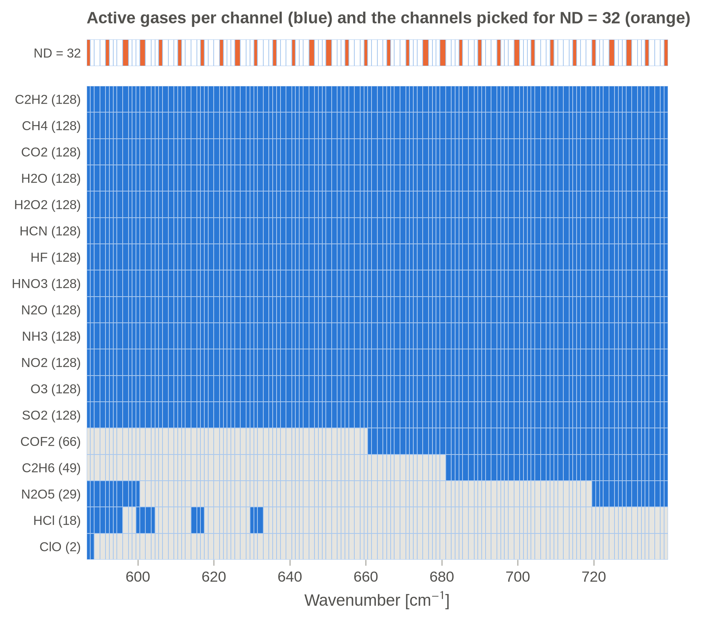
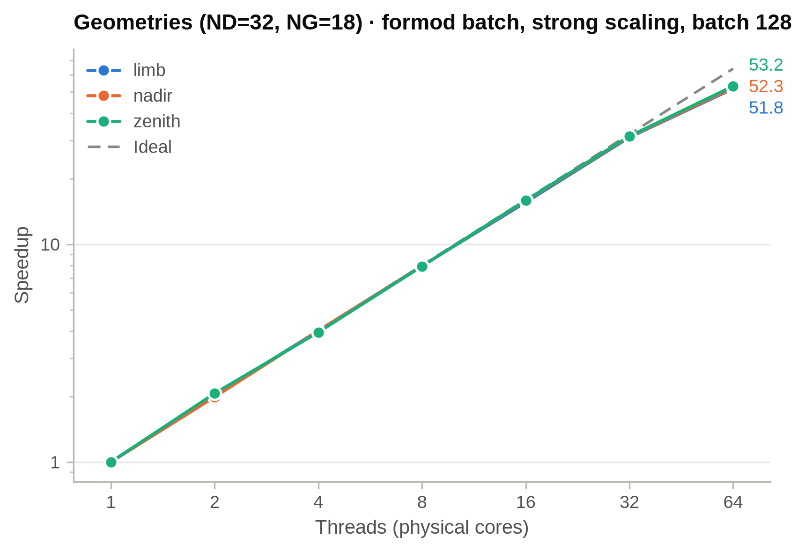
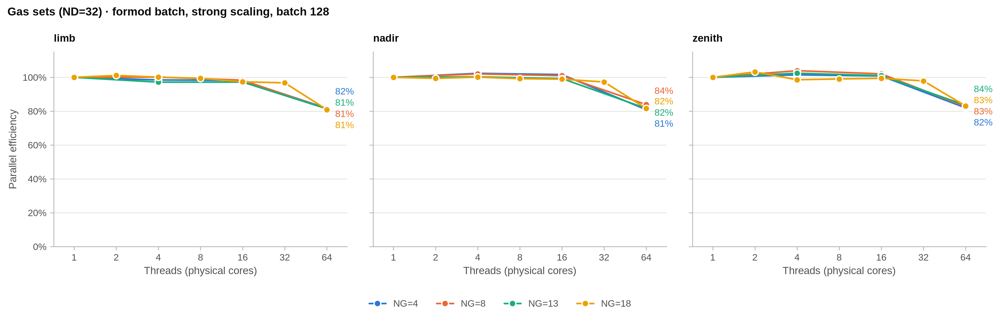
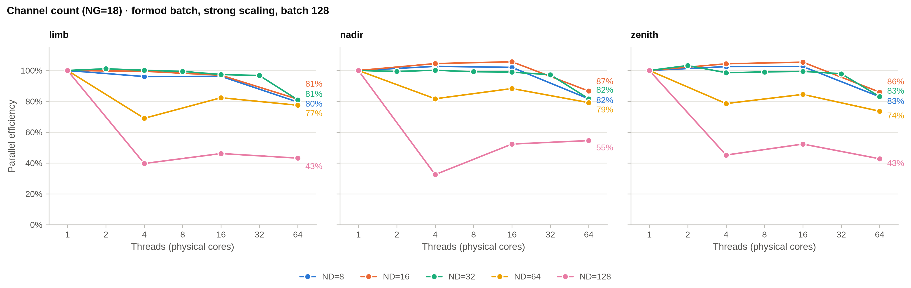
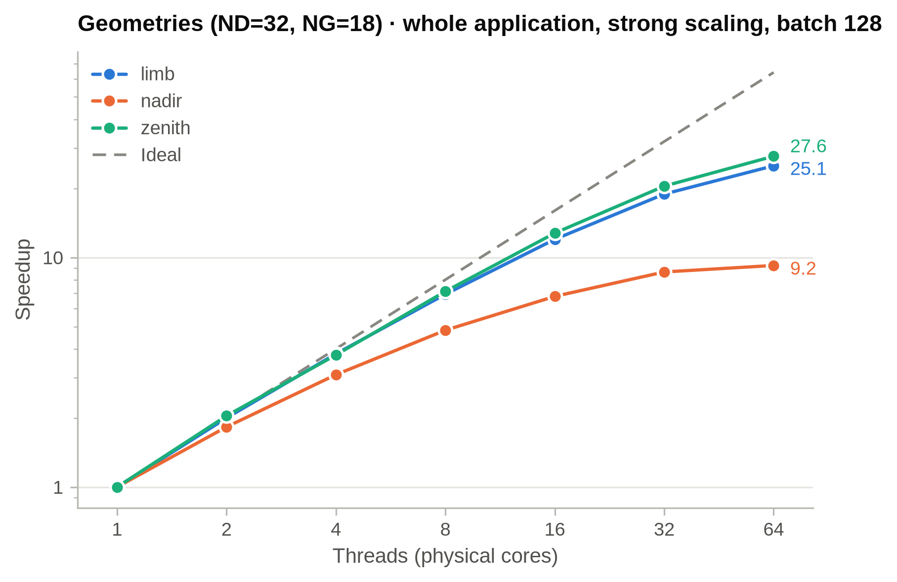

# CPU/OpenMP Benchmark

This benchmark measures how JURASSIC's forward model scales with OpenMP threads
when it calculates a fixed batch of independent atmospheric scenes. It tests
limb, nadir, and zenith viewing geometries. It also varies the number of
spectral channels and gases to show how workload size affects scaling.

## Benchmark design (`scaling_axes.sh`)

The reference configuration has 32 spectral channels, all 18 benchmark gases
(`ng18`), and a batch of 128 independent scenes. It is tested from 1 to 64
threads on one CPU socket, with the batch size held fixed (strong scaling).
The reference cases for each geometry are defined in
`configs/baseline_cases.tsv`.

Here, `ND` means the number of spectral channels and `NG` means the number of
gases in the selected gas set. The experiment varies geometry, channel count,
and gas set one at a time, keeping the other settings at their reference
values. The 32-channel setting lies in the middle of the tested channel range
(8–128), and `ng18` uses the full gas list.

The reference setting is timed on 1, 2, 4, 8, 16, 32, and 64 threads and is
the only setting used for the batch-size sweep. All other settings are timed
on 1, 4, 16, and 64 threads. Each setting is built for its own `ND` and `NG`.

The reported strong-scaling time covers one batched forward-model calculation
over 128 independent scenes. Lookup-table reading, the reference calculation,
and file I/O are timed separately and excluded from this main result. The batch
is evaluated through `formod_batch`, with one scene per thread at a time. If
`T1` is the one-thread batch time and `Tn` is the time on `n` threads, speedup
is `T1 / Tn` and parallel efficiency is `T1 / (n × Tn)`.

For practical reasons, the 128-scene one-thread time is estimated from a
shorter four-scene run. Direct full-batch single-thread checks for
representative configurations agree with that estimate within about ±1.1%.

### Channels and gases

JURASSIC only computes a gas in a channel if a lookup table exists for that gas at the channel's wavenumber. The runtime therefore depends on the number of active (channel, gas) pairs, i.e. the pairs for which a lookup table exists, and not simply on ND × NG. The file `configs/channels_alt3.tsv` contains a list of 128 channels between 587 and 739 cm⁻¹, each listed with the gases for which a lookup table exists. 



The script picks ND channels evenly spaced in the list, including the first and the last one (for ND = 32 every 4th or 5th channel), so they cover the whole range from 587 to 739 cm⁻¹. Each column in the figure is one channel of the list. The reference setting has 458 active channel-gas pairs.

The gas sets are defined in `configs/gas_sets/`. The name gives the number of gases, and each set contains the previous one plus some more gases:

| set | gases |
|---|---|
| `ng04` | CO2, H2O, O3, HNO3 |
| `ng08` | `ng04` + CH4, N2O, NH3, SO2 |
| `ng13` | `ng08` + C2H2, H2O2, HCN, HF, NO2 |
| `ng18` | `ng13` + C2H6, COF2, N2O5, HCl, ClO |

`ng13` contains exactly the 13 gases that are active in all 128 channels, so up to `ng13` the number of active pairs is NG × ND. `ng18` adds the 5 gases that are only active in parts of the range (+42 pairs at ND = 32) and is the full gas list.

### Execution

* `strong` (default): fixed batch size, 1 thread up to one socket.
* `t1check`: 1 thread on the full batch, to check the estimated `T1`
  (results in `jureca_scaling_axes_res/t1check/`).
* `batches` (default): one socket's threads over several batch sizes.
* `weak`: fixed scenes per thread.

```sh
cd projects/benchmark
sbatch run_scaling_axes_jureca.sh          # or run_scaling_axes_juwels.sh
python3 eval_scaling_axes.py runs/scaling_axes_<array job id>
```

The evaluation reports runtime, speedup and efficiency for the timed `formod_batch` call and for the whole application (adding table read, reference run and output), plus single-thread cost and efficiency vs batch size.

## Results (JURECA-DC, AMD EPYC 7742, one socket with 64 cores)

Batch of 128 scenes, threads pinned to socket 0. Results are in `jureca_scaling_axes_res/`.

For the 32-channel reference cases, all three geometries scale almost ideally
up to 32 threads. On 64 cores they reach about 52–53× speedup, or about
81–83% parallel efficiency.





The number of gases (NG) has no visible effect on the scaling. 



Up to 32 channels the efficiency does not depend on ND. With 64 and 128 channels it starts to decrease at 4 threads (128 channels: 43–55 % on 64 threads). This is most likely a memory limit, since the lookup tables grow from 29 MB (ND = 32) to 118 MB (ND = 128).



Including the table read, reference run and output, the speedup on 64 threads decreases to 28 (zenith), 25 (limb) and 9 (nadir). The time per phase for the reference setting (batch of 128 scenes) shows why:

| geometry | threads | table read | reference run | other I/O | formod batch | total |
|---|---:|---:|---:|---:|---:|---:|
| limb | 1 | 28.8 s | 6.1 s | 0.1 s | 796 s | 831 s |
| limb | 64 | 11.4 s | 6.2 s | 0.2 s | 15.4 s | 33 s |
| nadir | 1 | 21.0 s | 0.9 s | 0.1 s | 121 s | 143 s |
| nadir | 64 | 12.1 s | 1.0 s | 0.2 s | 2.3 s | 16 s |
| zenith | 1 | 33.0 s | 10.6 s | 0.1 s | 1366 s | 1409 s |
| zenith | 64 | 14.1 s | 10.7 s | 0.2 s | 25.7 s | 51 s |

Table read is `TIMER_READ_TBL`, reference run is `TIMER_FORMOD_REFERENCE` (one scene, computed on a single thread), other I/O is the remaining `TIMER_READ_*` plus `TIMER_WRITE_OBS` and `TIMER_FINALIZE`. The formod batch is the mean time of one batch from the `RUNTIME` line; on 1 thread it is the estimated `T1` (see above).
