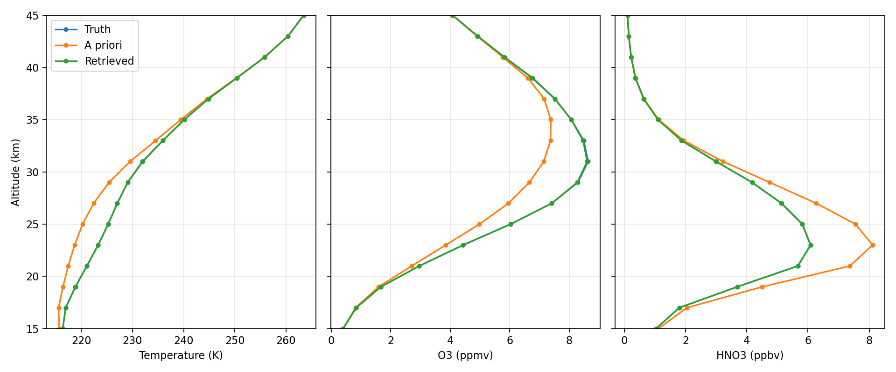
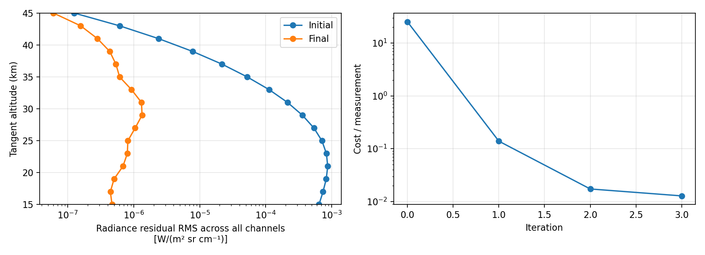
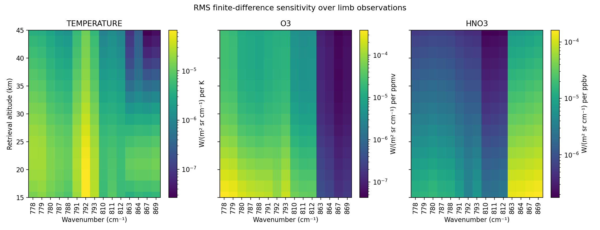
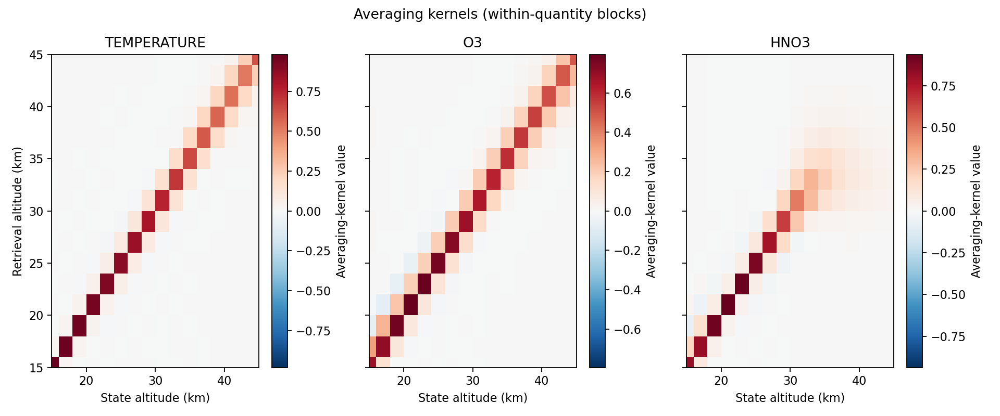
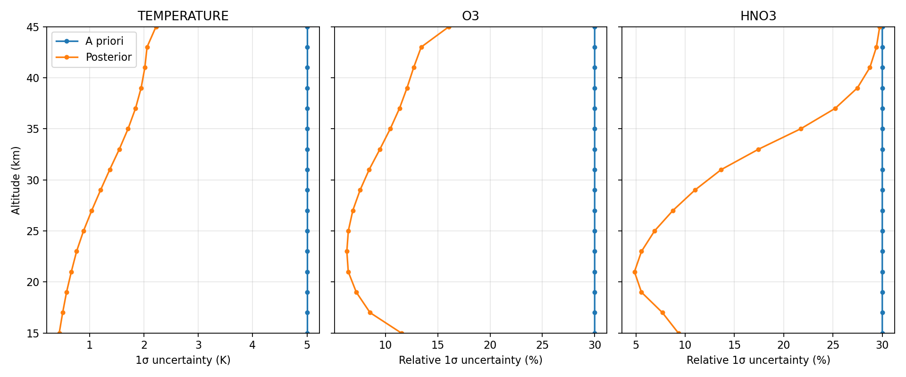

# Synthetic limb retrieval

This controlled end-to-end example tests JURASSIC's EGA forward model,
finite-difference Jacobians, and optimal-estimation retrieval together. It is
an illustrative numerical validation, not a realistic or optimized retrieval
for a particular instrument. The hypothetical limb sounder uses spectral
regions loosely associated with CO2 temperature, O3, and HNO3 sensitivity;
it does not reproduce CRISTA, MIPAS, or any other instrument.

## Setup

The example uses the existing 1 cm⁻¹ TRIA tables in
`tab/tria_1cm/nc_1e-6` (`TBLFMT = 3`). Its four emitters are CO2, H2O, O3,
and HNO3, indexed 0–3. It uses 15 channels: 791–793 and 810–812 cm⁻¹ for
the CO2 region, 778–780 and 787–788 cm⁻¹ for the O3 region, and 863, 864,
867, and 869 cm⁻¹ for the HNO3 region. All channels were checked against
the four table files. The `limb` utility generates 16 rays with tangent
altitudes 15, 17, …, 45 km from a 780 km observer.

`climatology` creates a 1–71 km atmosphere on a 2 km grid. `perturb.py`
creates the truth by adding a +5 K Gaussian centered at 25 km, multiplying
O3 by a Gaussian factor peaking at +25% at 28 km, and multiplying HNO3 by a
factor peaking at −25% at 23 km. Each Gaussian has a 5 km standard deviation.
The a priori remains the unperturbed climatology. The truth and a priori
radiances are calculated with the same EGA model; synthetic observations have
no added random noise. The measurement uncertainty is an assumed 0.0001
W/(m² sr cm⁻¹) absolute noise plus 0.1% of observed radiance as model error.

Temperature, O3, and HNO3 are retrieved at the 16 grid levels from 15 to
45 km. Pressure, CO2, and H2O are fixed. A priori standard deviations are
5 K for temperature and 30% of the a priori value for each retrieved gas.
Each quantity has a 5 km exponential vertical covariance length. The
standard convergence settings are used: at most 30 iterations, threshold
0.1, and Jacobian recomputation every third iteration.

## Run

From the repository root, build the bundled dependencies if needed, then
build the executables:

```sh
cd libs && bash build.sh
cd ../src && make -j
cd ..
projects/retrieval/run.sh
```

The script requires the existing TRIA tables at
`tab/tria_1cm/nc_1e-6/tria_*.nc`, plus Python 3, NumPy, and matplotlib.
It writes all generated files to ignored `projects/retrieval/work/` and
refuses to overwrite an existing run. Move or remove that directory
deliberately to repeat the calculation. Use `OMP_NUM_THREADS=1` for a
single-thread run; set it explicitly to study another thread count.

## Reference results

The `results/` directory contains selected committed output from the
documented single-thread run. Running `run.sh` reproduces the workflow in
the ignored `work/` directory, allowing users to inspect the reference
directly or compare it with a local rerun. The committed atmosphere files,
four core ASCII matrices, figures, and `metrics.json` document the state
and diagnostics without the temporary logs and intermediate products.

The reference run used one OpenMP thread on an Intel Core i7-1365U with core
source revision `4bc60a03`. It converged in **three iterations** and took
about 65 s through retrieval, including 18.84 s for the initial
finite-difference kernel. Timing ends before plotting. The iteration timer
also includes optimization and later Jacobian recomputation, so it is not a
pure Jacobian timer. These times are reference measurements, not speed
claims for other hardware.

| Diagnostic (15–45 km unless noted) | A priori / initial | Retrieved / final |
| --- | ---: | ---: |
| Temperature RMSE vs truth | 2.630 K | 0.022 K |
| O3 relative RMSE vs truth | 10.957% | 0.159% |
| HNO3 relative RMSE vs truth | 16.593% | 0.504% |
| Radiance residual RMS, all 240 ray/channel pairs [W/(m² sr cm⁻¹)] | 5.053e-4 | 7.418e-7 |

Gas profile errors are the RMS of levelwise percent errors relative to
synthetic truth. The radiance residual is observation minus model.
`results/metrics.json` gives the unrounded values; a local run writes its
own metrics and all signed radiance residuals to `work/`.

### Retrieved profiles



The three panels compare truth, a priori, and retrieved profiles over
15–45 km. The retrieval recovers the imposed smooth perturbations in this
internally consistent synthetic experiment.

### Radiance residuals and convergence



The left panel shows residual RMS over all 15 channels at each tangent
altitude. The right panel shows JURASSIC's cost per measurement by iteration;
the retrieval converged in three iterations.

### Finite-difference sensitivities



The heatmaps derive from the actual retrieval kernel in
`results/matrix_kernel.tab`, which has 240 measurement rows and 48 state
columns. They show RMS finite-difference sensitivity over the 16 limb
observations for each channel and state altitude. RMS removes derivative
sign; the plots show sensitivity magnitude and where the spectral regions
respond to temperature, O3, and HNO3. The last kernel written by retrieval
need not be evaluated at the exact final state when `KERNEL_RECOMP = 3`.
Temperature derivatives are shown per K, O3 per ppmv, and HNO3 per ppbv.
Each panel has its own logarithmic color scale.

### Averaging kernels



The within-quantity blocks of `results/matrix_avk.tab` diagnose vertical
retrieval response and information content. The trace of each block gives
degrees of freedom for signal (DOFS); its row sums give measurement response.

| Quantity | DOFS | Mean measurement response |
| --- | ---: | ---: |
| Temperature | 12.259 | 0.994 |
| O3 | 10.375 | 0.992 |
| HNO3 | 7.810 | 0.763 |

The lower HNO3 response indicates less uniform information over its 16
retrieved levels in this configuration. The full matrix also contains
cross-quantity blocks, which these three panels do not display.

### Formal uncertainties



Square roots of the diagonals of `results/matrix_cov_apr.tab` and
`results/matrix_cov_ret.tab` give formal 1σ uncertainties. The panels compare
their prior and posterior profiles. Temperature remains in K; gas
uncertainties are relative percentages, using the corresponding a priori or
retrieved VMR as denominator. The median 1σ reductions are **74.27%** for
temperature, **64.97%** for O3, and **62.78%** for HNO3. These formal
uncertainties describe the assumed error model of this controlled synthetic
retrieval, not a particular real instrument.

The analysis reads each matrix's 13-column ASCII format using explicit
zero-based matrix indices and checks its row/column metadata. The committed
reference output is a reproducibility aid, not a claim of real-instrument
retrieval accuracy.

## Finite differences and interpretation

`src/jurassic.c` computes forward-difference columns from a baseline
radiance and a positively perturbed state. The temperature step is fixed at
1 K (`KERNEL_T_ABS`); the gas step is the greater of 1% of the current
mixing ratio (`KERNEL_Q_REL`) and `1e-15` (`KERNEL_Q_MIN`). These values are
compile-time constants in `src/jurassic.h`, not control-file parameters.
This example uses the standard JURASSIC steps and writes the resulting
Jacobian for inspection. A 0.5×/1×/2× control-file step study is therefore
not available without separate builds, and the core algorithm is unchanged.

Improved profile and radiance RMSE demonstrate that the numerical workflow
recovers information from this internally consistent, noise-free experiment.
The Jacobians, averaging kernels, DOFS, and posterior covariances diagnose
the chosen synthetic setup; they do not predict performance for a specific
real instrument. There is no calibration, pointing, spectroscopy,
representativeness, or forward-model mismatch test. The small channel set
and fixed background gases are illustrative choices.

`tests/ret_test` is a small retrieval regression and I/O infrastructure
test. `projects/validation` tests forward-model spectra against RFM.
`projects/benchmark` measures forward-model CPU/OpenMP scaling.
`projects/retrieval` demonstrates and validates the synthetic end-to-end
retrieval workflow using the same TRIA table family as the latter two projects.
