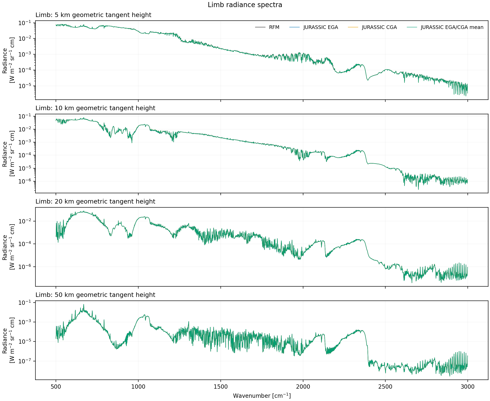
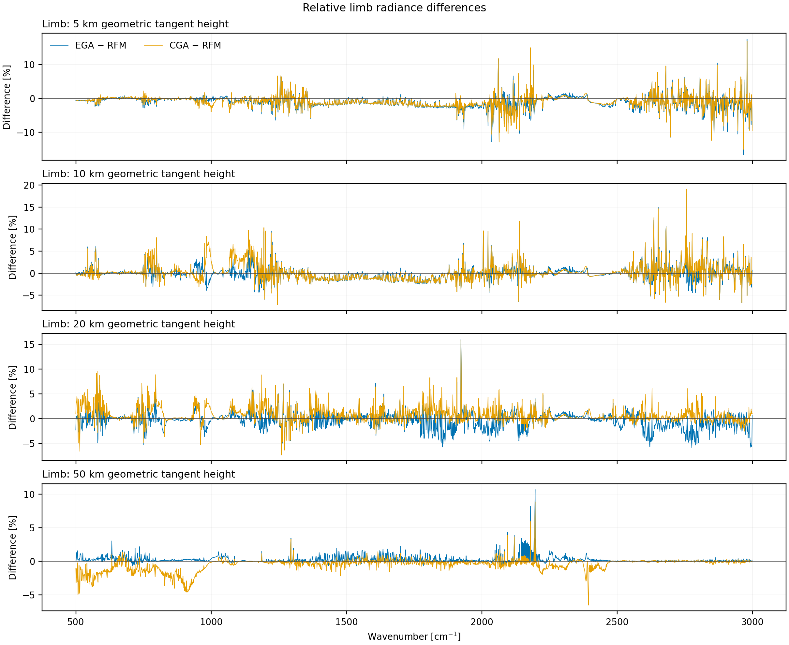
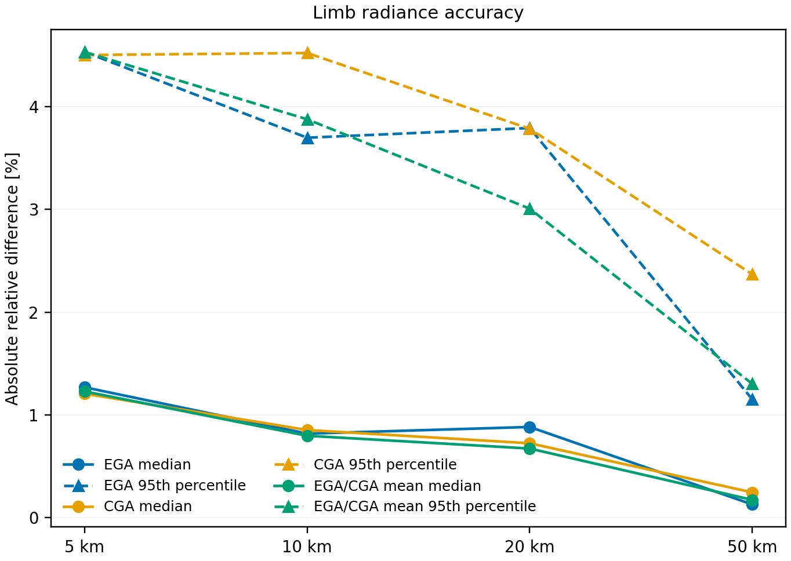
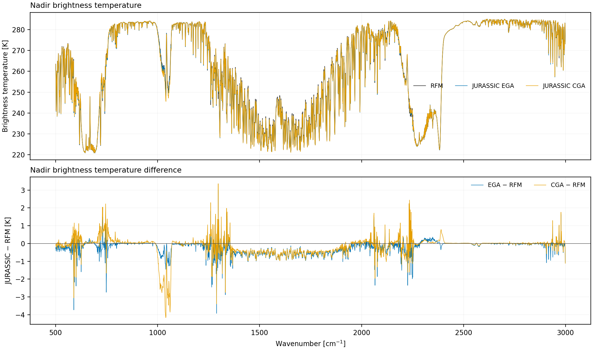
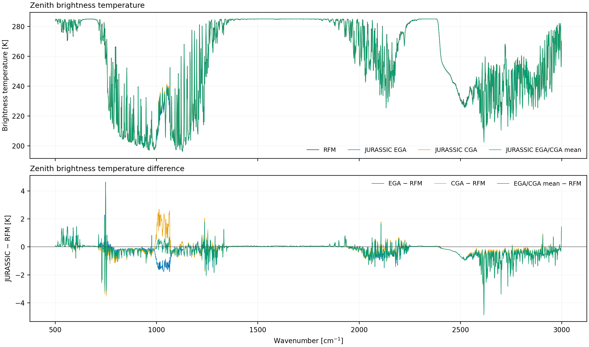
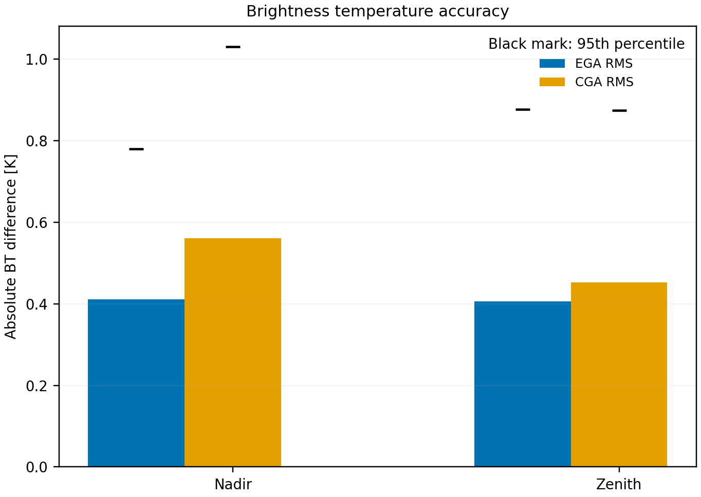
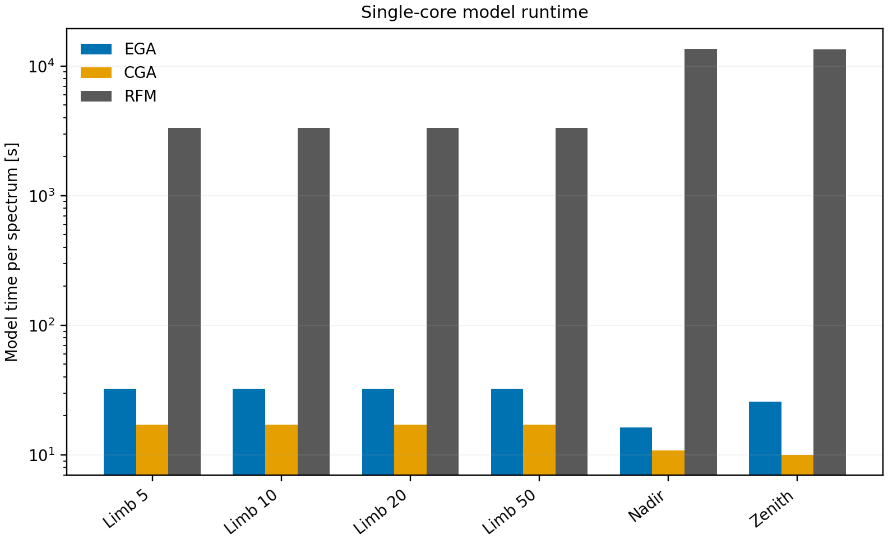

# JURASSIC–RFM spectral validation

This project validates the current CPU implementation of JURASSIC against the
Reference Forward Model (RFM), which provides a high-resolution line-by-line
reference. It asks how closely JURASSIC's EGA and CGA approximations reproduce
line-by-line radiances and how much they reduce the computational cost.

The comparison covers 2500 spectral channels from 500 to 2999 cm⁻¹ at 1 cm⁻¹
sampling, with 36 gases in the mid-latitude climatology. It includes limb rays
at geometric tangent heights of 5, 10, 20, and 50 km; refraction is enabled.
Nadir and zenith each use one representative vertical ray. RFM spectra are
calculated at a fixed 0.0005 cm⁻¹ spectral step and integrated with the same
spectral response functions used by JURASSIC.

The repository contains compact reference results:

- `rfm_reference/`: channel-matched RFM spectra, common inputs, timings, and provenance;
- `test_ega/`: JURASSIC EGA spectra and timings;
- `test_cga/`: JURASSIC CGA spectra and timings;
- `analysis/`: numerical accuracy metrics and publication-ready PNG figures.

Temporary spectral chunks, NetCDF files, and model logs are written below
`work/` and are not tracked by Git.

The committed EGA, CGA, and RFM results were generated from commit
`9a4bcfc14bbfaa39aa572cec525ca7f489d1eec9`.

## Validation results

### Detailed summary

For this configuration, typical JURASSIC–RFM radiance differences are at the
percent level or below. Nadir and zenith RMS brightness-temperature differences
are roughly 0.4–0.6 K. On the recorded single-thread reference system,
JURASSIC reduces model runtime by roughly two to three orders of magnitude
relative to RFM.

For this 2500-channel, 36-gas mid-latitude test, median absolute relative limb
radiance differences are 0.125–1.151% for EGA and 0.246–1.112% for CGA across
four tangent heights. The corresponding 95th percentiles are 1.147–4.260% and
2.368–4.496%. Nadir and zenith RMS brightness-temperature differences are
0.406–0.411 K for EGA and 0.452–0.561 K for CGA. On the recorded Intel Core
i7-1365U run, the observed speed-ups are 102–793× for RFM/EGA and 173–1287×
for RFM/CGA. These ratios compare total model time for each validation case:
limb is one joint four-ray calculation, while nadir and zenith contain one ray
each. The results are specific to this atmosphere, spectral responses, model
configuration, timing definition, and hardware.

### Limb spectra and errors







#### Limb error statistics

| Height | Method | RMS [%] | Median [%] | 95th percentile [%] | Maximum [%] |
|---:|:---|---:|---:|---:|---:|
| 5 km geometric | EGA | 2.199 | 1.151 | 4.260 | 17.479 |
| 10 km geometric | EGA | 1.762 | 0.713 | 3.395 | 17.910 |
| 20 km geometric | EGA | 1.773 | 0.850 | 3.802 | 15.995 |
| 50 km geometric | EGA | 0.607 | 0.125 | 1.147 | 10.704 |
| 5 km geometric | CGA | 2.116 | 1.112 | 4.207 | 16.899 |
| 10 km geometric | CGA | 2.009 | 0.750 | 4.496 | 19.071 |
| 20 km geometric | CGA | 1.742 | 0.672 | 3.881 | 15.895 |
| 50 km geometric | CGA | 1.056 | 0.246 | 2.368 | 8.883 |

The maximum percentages are retained for completeness. Their radiance context
is listed below; the absolute difference is not suppressed when the reference
radiance is weak. The maxima at 5, 10, and 50 km occur in weak-radiance
channels, while the 20 km maximum occurs at a larger radiance. Median and
95th-percentile values characterize the bulk of the 2500 channels more robustly.

| Height | Method | Channel [cm⁻¹] | RFM radiance [W m⁻² sr⁻¹ cm] | Absolute difference [W m⁻² sr⁻¹ cm] |
|---:|:---|---:|---:|---:|
| 5 km geometric | EGA | 2980 | 4.171396e-06 | 7.290976e-07 |
| 10 km geometric | EGA | 2756 | 1.591986e-06 | 2.851214e-07 |
| 20 km geometric | EGA | 1923 | 9.082896e-05 | 1.452847e-05 |
| 50 km geometric | EGA | 2197 | 3.058876e-06 | 3.274091e-07 |
| 5 km geometric | CGA | 2980 | 4.171396e-06 | 7.049242e-07 |
| 10 km geometric | CGA | 2756 | 1.591986e-06 | 3.036099e-07 |
| 20 km geometric | CGA | 1923 | 9.082896e-05 | 1.443728e-05 |
| 50 km geometric | CGA | 2197 | 3.058876e-06 | 2.717155e-07 |

### Nadir and zenith brightness temperature







#### Brightness temperature error statistics

| Geometry | Method | RMS [K] | Median [K] | 95th percentile [K] | Maximum [K] |
|:---|:---|---:|---:|---:|---:|
| Nadir | EGA | 0.411 | 0.113 | 0.780 | 3.906 |
| Zenith | EGA | 0.406 | 0.071 | 0.877 | 4.501 |
| Nadir | CGA | 0.561 | 0.102 | 1.030 | 4.171 |
| Zenith | CGA | 0.452 | 0.065 | 0.874 | 4.191 |

### Runtime



The table shows total model time for each validation case. The timing definition
and reference hardware are described below. The reported JURASSIC runtime
refers to the forward-model calculation itself. Lookup-table reading and
initialization (`READ_TBL`) are measured separately and are not included in
the JURASSIC model-time values or RFM/JURASSIC speed-up ratios.

| Geometry | EGA [s] | CGA [s] | RFM [s] | RFM/EGA | RFM/CGA |
|:---|---:|---:|---:|---:|---:|
| Limb (4 rays) | 112.03 | 65.66 | 11375.76 | 102× | 173× |
| Nadir (1 ray) | 14.50 | 8.93 | 11495.12 | 793× | 1287× |
| Zenith (1 ray) | 22.99 | 10.91 | 11285.60 | 491× | 1034× |

## Interpreting approximation errors

EGA follows the growth of channel-mean emissivity along an inhomogeneous ray,
while CGA represents the path by equivalent homogeneous conditions. Both are
band approximations. They do not exactly retain correlations between the
spectral variation of the Planck function and emissivity along the path.
Combining the mean transmissions of individual gases also neglects correlations
between overlapping gas absorption structures within a channel. The method and
these residual correlation terms are described by
[Baumeister and Hoffmann (2022)](https://doi.org/10.5194/gmd-15-1855-2022).

Errors therefore depend on the spectral interval, instrument response,
atmospheric state, gas overlap, and viewing geometry. Published results for
other configurations are useful context rather than general error bounds.
Gordley and Russell (1981) reported about 0.5% for a single-gas broadband limb
case, and Francis et al. (2006) reported channel-dependent radiance accuracies
of 0.5-1.0% or better for the HIRDLS fast model, which combined CGA, EGA, and
statistical regression. Each instrument or application must be validated
against line-by-line calculations using its own spectral response functions.

References: [Gordley and Russell (1981)](https://doi.org/10.1364/AO.20.000807),
[Marshall et al. (1994)](https://doi.org/10.1016/0022-4073(94)90026-4), and
[Francis et al. (2006)](https://doi.org/10.1029/2005JD006270).

## Lookup-table applicability

This validation applies to the lookup-table set and atmospheric state used
here. The following details show how that state relates to the tabulated
parameter ranges and where extrapolation occurs.

The external netCDF tables contain packed grids for each gas and channel rather
than one global pressure, temperature, or absorber-column range in the netCDF
metadata. Representative active variables in the table set used for this run
have a pressure grid of 0.0103181–1017 hPa. The committed atmosphere spans
0.00184003–1017 hPa: its ten levels from 81 to 90 km fall below that grid
and therefore require pressure extrapolation when sampled. Its temperatures
are within the pressure-dependent temperature grid of the representative CO2
table checked at 1500 cm⁻¹. This check does not establish the domain of every
gas/channel table.

Absorber-column grids differ by gas, channel, pressure, and temperature.
JURASSIC interpolates pressure logarithmically and temperature linearly and
uses the boundary grid pairs for extrapolation. Below a tabulated column range,
emissivity is scaled linearly; above it, an exponential continuation approaches
unity. These continuations keep the calculation defined but do not establish
line-by-line accuracy outside the sampled state space.

The runner requires all 36 table files and verifies that every requested CO2
and H2O channel is present. Other gases may cover only their active spectral
regions; the core emits a warning and applies zero absorption for an
individual missing gas/channel table. New table sets and atmospheres must be
checked separately, especially near pressure, temperature, and column-density
boundaries. Accuracy outside or near those boundaries should not be inferred
from this validation.

## Inspect and reproduce the analysis

The supplied spectra are sufficient to reproduce every accuracy metric and
figure without installing RFM or obtaining the external lookup tables:

```bash
python3 projects/validation/analyze.py
```

The analysis reports relative radiance differences for all limb channels with
nonzero RFM radiance. A true zero reference would be reported as undefined.
For nadir and zenith, the channel-averaged radiances are converted with
JURASSIC's inverse Planck definition and differences are reported in kelvin.

Main outputs are:

```text
analysis/accuracy_metrics.csv
analysis/limb_radiance_spectra.png
analysis/limb_relative_errors.png
analysis/nadir_brightness_temperature.png
analysis/zenith_brightness_temperature.png
analysis/limb_accuracy_summary.png
analysis/brightness_temperature_accuracy_summary.png
analysis/runtime_summary.png
```

The limb spectra use a logarithmic radiance axis. Nadir and zenith are shown
separately as brightness temperatures with their absolute differences in
kelvin. Accuracy and runtime summaries are separate figures. The principal
accuracy and timing results are tabulated above.

## Repeat the calculations

Build the CPU executables with capacity for all 36 gases:

```bash
cd src
make clean
make DEFINES=-DNG=40 -j
```

Supply the external JURASSIC lookup-table directory with `JURASSIC_TBL_DIR` or
`--tbl-dir`.
It must contain `tria_<gas>.nc` for all gases recorded in the manifests. The
lookup tables are not part of this repository. Its H2O table must have been
generated with RFM `H2O(sub)` for consistency with JURASSIC's MT_CKD 4.1
continuum. All generated control files use `TBLFMT 3`.

Generate the RFM reference first:

```bash
python3 projects/validation/run_rfm.py --force
```

Defaults can be overridden with `RFM_BIN`, `RFM_HIT`, and `RFM_XSC_DIR`, or
the corresponding command-line options. RFM, HITRAN data, cross sections, and
the instrumented RFM timing copy remain external dependencies.

Then repeat either JURASSIC calculation:

```bash
python3 projects/validation/run_ega.py --force
python3 projects/validation/run_cga.py --force
python3 projects/validation/analyze.py
```

Each calculation uses one model thread. By default the spectral chunks run
sequentially, with the model process restricted to logical CPU 0 on the
reference notebook. Set `VALIDATION_JOBS` and `VALIDATION_CPUSET` for another
machine; an empty `VALIDATION_CPUSET` disables affinity. Existing compact
results are replaced only with `--force`, and only after the new calculation
has completed successfully.

EGA and CGA regenerate the deterministic atmosphere and geometries and compare
them against `rfm_reference/input/` before accepting their results. Thus all
three methods use the same atmospheric state and viewing geometry. In RFM
mode, JURASSIC applies the spectral response stored in each TRIA channel to
the high-resolution RFM output; arbitrary monochromatic RFM samples are not
used as references. With these 1 cm^-1 tables, adjacent channel responses overlap
and each of the 20 chunks forms one contiguous RFM block. RFM is therefore
started 20 times per geometry.

## Timing interpretation

`timings.csv` records the summed single-process times across spectral chunks.
JURASSIC model time is `TIMER_FORMOD`. Instrumented RFM model time is the
reported path plus spectral phases minus output time. The runtime table uses
the total model time for each validation case: limb contains four jointly
calculated rays, while nadir and zenith contain one ray each. A limb RFM
invocation shares its spectral setup and HITRAN processing across all four rays,
so its total time is not the cost of four independent RFM runs. The CSV file
also records the resulting amortized throughput time per spectrum. Parallel
jobs reduce elapsed execution time but do not alter these summed single-process
model times.

Each result manifest records the CPU model, physical and logical CPU counts,
and the logical CPUs made available to the model processes. The supplied
reference timings were measured on a 13th Gen Intel Core i7-1365U with 10
physical cores and 12 logical CPUs. One single-thread process ran at a time,
restricted to logical CPU 0.

`READ_TBL` includes reading and preparing the lookup tables. RFM timing keeps
its HITRAN initialization and binary-read measurements separately. Hardware,
thread count, external-data provenance, and the timing definition must remain
with any reported speed-up.
